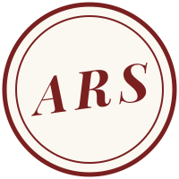

<p align="center">
  <a href="https://ars2k03.tech">
    
  </a>
</p>

<h1 align="center">A R S</h1>

<p align="center"><strong>Portfolio + personal RAG assistant monorepo</strong></p>

<p align="center">
  <a href="https://ars2k03.tech"><strong>Live site</strong></a> ·
  <a href="https://ars2k03.tech/assistant"><strong>Assistant</strong></a> ·
  <a href="https://github.com/ars2k03/ars-arafat-portfolio"> <strong>GitHub</strong></a> ·
  <a href="https://gitlab.com/ars2k03/ars-arafat-portfolio"> <strong>GitLab</strong></a>
</p>

---

## Structure

```text
ars/
├── apps/
│   ├── client/    # Next.js portfolio + /assistant UI
│   └── server/    # FastAPI RAG backend (Qdrant + Groq + Gemini)
├── assets/        # GitHub & GitLab SVG logos
├── packages/      # shared packages (optional)
├── resume/        # LaTeX source & compiled PDF resume
├── pnpm-workspace.yaml
└── turbo.json
```

| App | Path | Stack |
|-----|------|--------|
| **Client** | [`apps/client`](apps/client) | Next.js 16.4.6 · React 19.3.1 · Tailwind 4.3.5 · TypeScript 7 |
| **Server** | [`apps/server`](apps/server) | FastAPI · LangChain · Qdrant |

## Repositories & Remotes

This repository is mirrored across **GitHub** and **GitLab**.

| Platform | Remote | Repository | Clone URL |
|----------|--------|------------|-----------|
|  **GitHub** | `origin` | [ars2k03/ars-arafat-portfolio](https://github.com/ars2k03/ars-arafat-portfolio) | `https://github.com/ars2k03/ars-arafat-portfolio.git` |
|  **GitLab** | `gitlab` | [ars2k03/ars-arafat-portfolio](https://gitlab.com/ars2k03/ars-arafat-portfolio) | `git@gitlab.com:ars2k03/ars-arafat-portfolio.git` |

## Prerequisites

- Node.js 24+ (see `apps/client/.nvmrc`)
- pnpm **12.21.0**
- Python 3.12+ (for the assistant backend)
- API keys: Resend (contact form), Google AI, Groq, Qdrant (assistant)

## Setup

**Clone from GitHub:**

```bash
git clone https://github.com/ars2k03/ars-arafat-portfolio.git
cd ars-arafat-portfolio
```

**Or clone from GitLab:**

```bash
git clone git@gitlab.com:ars2k03/ars-arafat-portfolio.git
cd ars-arafat-portfolio
```

**Configure multiple remotes (optional for maintainers):**

```bash
git remote add gitlab git@gitlab.com:ars2k03/ars-arafat-portfolio.git
git remote -v
git push origin main && git push gitlab main
```

**Install dependencies & configure environment:**

```bash
pnpm install

# Client env
cp apps/client/.env.example apps/client/.env

# Server env + venv
cp apps/server/.env.example apps/server/.env
cd apps/server
python3 -m venv venv
source venv/bin/activate
pip install -r requirements.txt
# add knowledge files under my_data/, then:
python ingest.py
cd ../..
```

## Develop

```bash
# both apps (Turbo)
pnpm dev

# separately
pnpm dev:client
pnpm dev:server
```

- Portfolio: [http://localhost:3000](http://localhost:3000)
- Assistant UI: [http://localhost:3000/assistant](http://localhost:3000/assistant)
- RAG API: [http://localhost:8000](http://localhost:8000)

## Scripts

| Command | Description |
|---------|-------------|
| `pnpm dev` | Run client + server via Turborepo |
| `pnpm build` | Build client |
| `pnpm lint` | Lint client |
| `pnpm typecheck` | Typecheck client |

## Author

**Md Arafat Rahman Sohan (A R S)** — [ GitHub](https://github.com/ars2k03) · [ GitLab](https://gitlab.com/ars2k03)

## License

MIT — see [LICENSE](LICENSE).

Copyright © Md Arafat Rahman Sohan (A R S).
